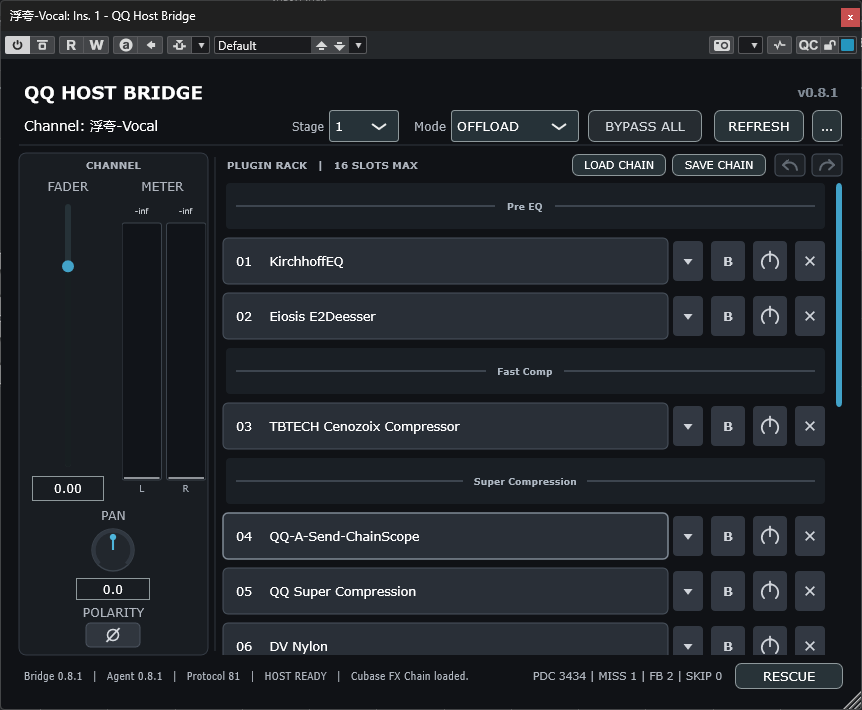

# QQ Host Suite 1.4.44 Stable

## 1. 产品介绍 / About the product

QQ Host 是面向 DAW 混音的效果器托管机架。当一条轨道的插件链先于整机 CPU 达到实时处理极限时，可以在轨道 Insert 中放入 QQ Host Bridge，让配套后台 QQ Host 承载效果器。工程、路由及自动化仍由 DAW 管理，不需要另开一个混音系统。

QQ Host is an effect rack for DAW mixing. When one track's plug-in chain reaches its real-time processing limit before the computer's overall CPU is fully used, insert QQ Host Bridge and let its companion background app host the effects. The DAW continues to manage the session, routing and automation; no separate mixer is required.

混音时可测量负载、应用缓冲和分段方案，也可用 ▲ / ▼ 调整 buffer；录音监听可切换 LIVE。每个 Bridge 提供最多 16 个主插件槽和 2 个侧链效果器槽，并支持 Divider、预置、自动化、DAW 工程恢复、Classic / Light / Dark 界面及电平、声像和极性控制。Windows 托管原生 64 位 VST2/VST3 效果器，macOS 另支持 AUv2/AUv3 效果器。

For mixing, measure the workload and apply a buffering/stage plan, or adjust buffering with ▲ / ▼. Switch to LIVE for immediate monitoring. Each Bridge offers up to 16 main slots and two sidechain-effect slots, plus Dividers, presets, automation, project recall, Classic / Light / Dark themes, and level, pan and polarity controls. Windows hosts native 64-bit VST2/VST3 effects; macOS also hosts AUv2/AUv3 effects.

图示为 0.9.2 历史界面。外部硬件详见新版 Bridge 手册 14A–14G 页和 Live 手册 4A–4G 页。
The image shows the historical 0.9.2 UI. For external hardware, see pages 14A–14G in the Bridge manual and 4A–4G in the Live manual.

QQ Host 改变托管和调度方式，但不会改写第三方插件内部的算法。性能改善取决于插件、音频缓冲、路由和电脑配置；增加 buffer 会增加延迟，不能消除持续的处理超负荷。QQ ChainScope 是另行安装的产品，不包含在本包中。

QQ Host changes hosting and scheduling, not the DSP algorithms inside third-party effects. Benefits depend on plug-ins, audio buffering, routing and hardware. More buffering adds latency and cannot remove sustained overload. QQ ChainScope is a separate installation and is not included.

Windows 还提供 Live 独立机架，可对麦克风和电脑输入插入效果、分配总线及设置监听；Live 不是 macOS 包中的组件。

Windows also includes the standalone Live rack for mic and computer inputs, effects, bus routing and monitoring. Live is not part of the macOS package.

Live 和 Bridge 内置可选真峰值限幅器；Windows 本机的 Agent 可在用户授权后辅助操作机架。与第三方软件联用不会自动赋予其权限。

Live and Bridge include optional true-peak limiting. On Windows, a local Agent can assist with mixing after the user pairs it; using third-party software does not grant access automatically.

在 Live 中可以直接给硬件槽分配声卡发送／返回。Bridge 由 DAW 管理物理端口，请将 QQ Hardware I-O 直接放在 DAW 的专用路由轨，再与 Bridge 内的硬件槽配对。

In Live, assign interface ports to the hardware insert. In Bridge, pair the insert with QQ Hardware I-O on a dedicated DAW routing track; the DAW owns the physical ports.

## 2. 许可证 / License

QQ Host 为 Qing Audio 的闭源专有软件，产品源码不公开。本仓库仅提供公开说明、界面图片及发布成品；下载本页文件不授予源码或额外许可权利。第三方组件的许可独立适用。

QQ Host is closed-source proprietary software from Qing Audio; its product source is not public. This repository contains public documentation, screenshots and release downloads only. Downloading these files does not grant source-code or additional license rights. Third-party component licenses apply independently.

## 3. 安装包与手册 / Installers and manuals

[QQ Host 1.4.44 Stable](https://github.com/Qing-Audio/QQHost-Release/releases/tag/v1.4.44)

发布时间 / Release date: 2026-11-27. 更新前保存工程并退出使用本产品的程序。macOS 12+；Live 仅限 Windows。Save your work and close apps using the suite before upgrading. macOS 12+; Live is Windows-only.

| 文件 / File | 下载 / Download |
|---|---|
| Windows x64（Host、Live、Bridge 与 Hardware I-O VST3） | [QQ.Host.Suite.1.4.44.Windows.x64.Setup.exe](https://github.com/Qing-Audio/QQHost-Release/releases/download/v1.4.44/QQ.Host.Suite.1.4.44.Windows.x64.Setup.exe) |
| macOS Intel / Apple Silicon（Host、Bridge 与 Hardware I-O AU/VST3） | [QQ.Host.Suite.1.4.44.macOS.Universal.Setup.pkg](https://github.com/Qing-Audio/QQHost-Release/releases/download/v1.4.44/QQ.Host.Suite.1.4.44.macOS.Universal.Setup.pkg) |
| 中文安装说明 | [QQ.Host.Suite.1.4.44.Installation.Guide.Chinese.txt](https://github.com/Qing-Audio/QQHost-Release/releases/download/v1.4.44/QQ.Host.Suite.1.4.44.Installation.Guide.Chinese.txt) |
| English installation guide | [QQ.Host.Suite.1.4.44.Installation.Guide.English.txt](https://github.com/Qing-Audio/QQHost-Release/releases/download/v1.4.44/QQ.Host.Suite.1.4.44.Installation.Guide.English.txt) |
| Host / Bridge 中文手册 | [QQ.Host.1.4.44.User.Manual.Chinese.pdf](https://github.com/Qing-Audio/QQHost-Release/releases/download/v1.4.44/QQ.Host.1.4.44.User.Manual.Chinese.pdf) |
| Host / Bridge English manual | [QQ.Host.1.4.44.User.Manual.English.Edition.pdf](https://github.com/Qing-Audio/QQHost-Release/releases/download/v1.4.44/QQ.Host.1.4.44.User.Manual.English.Edition.pdf) |
| Live 独立机架中文手册 | [QQ.Host.Live.1.4.44.Standalone.Rack.User.Manual.Chinese.pdf](https://github.com/Qing-Audio/QQHost-Release/releases/download/v1.4.44/QQ.Host.Live.1.4.44.Standalone.Rack.User.Manual.Chinese.pdf) |
| Live standalone rack English manual | [QQ.Host.Live.1.4.44.Standalone.Rack.User.Manual.English.Edition.pdf](https://github.com/Qing-Audio/QQHost-Release/releases/download/v1.4.44/QQ.Host.Live.1.4.44.Standalone.Rack.User.Manual.English.Edition.pdf) |

先关闭音频软件再安装。Windows 安装包包含 Live、Host 以及 Bridge 和 Hardware I-O 两个 VST3，可选择 Live 目录。Mac 通用安装包包含 Host.app，以及 Bridge 和 Hardware I-O 的 VST3 和 AU，支持 Intel 和 Apple Silicon，不含独立 Live。两端均不安装 QQSpeaker 驱动。GitHub 自动显示的 “Source code” 压缩包只含本下载仓库的公开资料，不是安装包。

Quit audio applications before installation. Windows Setup installs Host, Live, and both the Bridge and Hardware I-O VST3 and lets you choose the Live folder. The Universal Mac installer includes Host.app plus Bridge and Hardware I-O in VST3 and AU formats for Intel and Apple Silicon; it does not include Live. Neither installer includes a QQSpeaker driver. GitHub’s automatic “Source code” archives contain only the public download repository, not the product or installers.

Windows 安装包未作 Authenticode 签名；Mac 组件为 ad-hoc 签名，安装包未获 Apple 公证。如被系统策略阻止，请联系发布者，不需要关闭系统安全保护。The Windows installer has no Authenticode signature. Mac bundles are ad-hoc signed and the installer is not notarized; if blocked, contact the publisher rather than disabling system security.

## 4. 逐版本更新 / Version history

### 1.4.44 — Stable

新建硬件槽：Live 的 PHASE 和两路 EQ Match 默认 10 ms；Bridge 默认 40 ms。已保存的设置不变。

New hardware inserts start at 10 ms in Live and 40 ms in Bridge for PHASE and both EQ Match targets. Saved settings are unchanged.

### 1.4.43

更换校正精度会清除旧模型并复位开关，不清除硬件往返或手动极性。保留冻结波形和手动放大，移除自动细节小窗。

Changing correction quality clears learned models and resets their switches, not the measured round trip or manual polarity. Frozen waveforms keep manual zoom without an automatic detail inset.

### 1.4.42

PHASE 联动匹配 EQ 的最小相位／线性相位方式；Wet、Main 各保留自己的匹配曲线和 Amount、Smooth。

PHASE controls whether matching EQ uses minimum or linear phase; Wet and Main retain separate curves, Amount and Smooth.

### 1.4.41

ECO 关窗时停止观察；收起图表时停止频谱、波形和 EQ 学习。已启用的校正仍处理声音。

ECO stops observing when the editor is closed and stops spectrum, waveform and EQ analysis when the graphs are collapsed. Applied corrections still process audio.

### 1.4.40

冻结后调 Wet 或 Main，可观察同一片段的输出频谱、波形、响度、峰值和 RMS 如何改变。

With analysis frozen, edit Wet or Main to compare its spectrum, waveform, loudness, peaks and RMS on the same passage.

### 1.4.39

统一硬件分析的刷新与冻结。全局 ECO/FULL 在 Live 内覆盖同一机架，在 Bridge 内覆盖同一 DAW 的已有硬件槽。

Hardware analysis shares Refresh and Freeze. Global ECO/FULL affects existing inserts across one Live rack or across Bridges in the same DAW.

### 1.4.38

轨道按实测完整往返报告硬件延迟，不扣除声卡缓冲；更新 ChainScope 对齐所用的时间信息，不再给湿声重复加延迟。

Track latency includes the measured hardware round trip, without subtracting interface buffers. ChainScope receives the corresponding timing without delaying the wet signal again.

### 1.4.37

Live 的逐轨延迟纳入已校准的硬件；同轨 ChainScope A、B、C 可以发现并连接到正确的组。

Live track latency accounts for calibrated hardware. ChainScope A, B and C can discover and reconnect to their group on the same rack track.

### 1.4.36

Live 新增全部旁通，包含内置 LIM；关闭全部旁通会恢复各槽原状态。硬件窗口可在冻结波形上比较 Ø 和 PHASE。

Live’s Bypass All includes built-in limiters and preserves individual bypass states. The hardware window previews polarity and PHASE changes on a frozen waveform.

### 1.4.35

硬件分析新增冻结；改进 Live 路由延迟统计、Bridge 性能测试的取消操作和插槽菜单。

Added hardware analysis freeze, revised Live routed delay handling, and improved Bridge test cancellation and rack menus.

### 1.4.34

Live 在每轨总延迟旁显示处理负荷；调整硬件校准和设置布局。

Live displays track processing load beside total latency. Hardware calibration and settings were revised.

### 1.4.33

Live 的物理硬件发送与监听输出在当前设备回调内提交，减少额外排队。

Live submits physical sends and monitor outputs in the device callback that produces them, reducing unnecessary queuing.

### 1.4.32

硬件槽改用颜色标记；新增全局与单槽分析模式，以及相位和匹配 EQ 的质量选择。

Hardware inserts use a color accent, with global and per-insert analysis modes and quality controls for phase and matching EQ.

### 1.4.31

Live 和 Bridge 共用 B Return 风格的硬件面板：对齐 Before/Wet，对照频谱、波形、读表与 EQ Match。

Live and Bridge share a B Return-style hardware panel with aligned Before/Wet signals, spectra, waveforms, meters and EQ Match.

### 1.4.30

修正单声道轨送往立体声硬件；加入往返测量、手动补偿、响度匹配与相位校准。

Fixed sending a mono track to stereo hardware and added round-trip measurement, manual alignment, loudness matching and phase calibration.

### 1.4.29

Live 和 Bridge 加入外部硬件插入、命名硬件库及临时接线。Bridge 通过 DAW 的 QQ Hardware I-O 收发。

Added external hardware inserts, named hardware and temporary routing. In Bridge, QQ Hardware I-O sends and receives through the DAW.

### 1.4.28 — Stable

在 Live 目标轨的 INSERTS 右键，或在 Bridge 点 SAVE CHAIN / LOAD CHAIN，先选保存或加载，再选「1. Cubase 预置链」或「2. QQ Host 原生链」。Live 的 Studio One 是单独的导入命令。四本中英文手册仅修订了这些操作。

Right-click the target track’s INSERTS in Live, or click SAVE CHAIN / LOAD CHAIN in Bridge. Both menus list Cubase first and QQ Host native second. Studio One import is separate in Live. Only these chain instructions changed in the Chinese and English manuals.

### 1.4.27

两种格式默认使用各自的库。Cubase 用户链和 QQ Host 原生链不混放；原生链可以在 Live 与 Bridge 之间保留 Divider 和顺序，旧原生链仍可打开。

Each format opens its own library. Native chains retain Dividers and their positions between Live and Bridge. Existing native chains remain readable.

### 1.4.26

Windows Live 可在未安装 Cubase 的电脑上，把插入链保存为 .fxchainpreset；这不会迁移或转换已有的 .qqchain。

Windows Live can save an insert chain as .fxchainpreset without Cubase installed. Existing .qqchain files are not moved or converted.

### 1.4.25

Windows Live：Studio One 效果链里有外部侧链时，不再整条拒载。Live 按原顺序导入串联插件，保留可恢复的参数和旁通状态，并指出哪些外部侧链未连接。外部发送不会自动接到本机麦克风或其他轨道；需要原来的触发效果时请手动重接。

Windows Live now imports serial Studio One chains that reference an external sidechain. It keeps the insert order, recoverable settings and bypass states, and identifies the disconnected sidechain slots. External sends are never connected to a local input automatically; reconnect the source if the effect needs it.

### 1.4.24

Live 改善了对旧扫描目录中 Pro-Q 3 等 VST3 的匹配，并支持带 FXB 状态的 Studio One VST2 链，例如 Ozone 9。找不到对应格式的插件时，保留缺失槽及已读取的状态，不拿其他插件代替。

Live better identifies VST3 effects such as Pro-Q 3 in older scan catalogs and imports Studio One VST2 chains with FXB state, including Ozone 9. If the matching format is unavailable, Live retains the missing slot and its saved state instead of substituting another plug-in.

### 1.4.23

Live 增加对 Fender Studio Pro 8 所保存 FX Chain 容器的识别，可导入其中的串联第三方 VST3 效果器。

Live recognizes the FX Chain container written by Fender Studio Pro 8 and can import its serial third-party VST3 inserts.

### 1.4.22

Live 的轨道 INSERTS 菜单可直接读写 QQ Host 原生 .qqchain 或 Cubase 串联 .fxchainpreset，也可导入 Studio One 的串联 .multipreset。只替换目标轨的插槽，不改推子和声卡路由。要在 Cubase 原生插槽中打开，请在第一次保存时选「Cubase 插入链」；要在 QQ Host 中保留分隔线，选原生格式。

Use a track’s INSERTS menu to load or save a native QQ Host .qqchain or a serial Cubase .fxchainpreset, or import a serial Studio One .multipreset. Only that track’s inserts are replaced. Choose the Cubase format when saving for Cubase; choose the native format to retain Live’s dividers.

### 1.4.21 — Stable

Live：在设置中点击「复制 Agent 连接说明」即可取得可直接交给 Agent 的文字，不含长期令牌。授权后，Agent 可在音频运行时向轨道末尾追加效果器；新插件准备好后才接入，加载失败不改变原来的插件链。

Live: Copy ready-to-use agent connection instructions from Settings without exposing your long-term token. An authorized agent can append an effect without stopping rack audio. The new effect joins when it is ready; a failed load leaves the existing chain unchanged.

### 1.4.20

Live、Bridge：改进内置 LIM 的增益控制，减轻持续深压时的失真；不增加监听延迟。保留真峰值保护及原有预置、GR 表与 5 秒 TP HOLD。

Live and Bridge: The built-in limiter reduces distortion under sustained gain reduction without adding monitoring latency. True-peak protection, presets, the gain-reduction meter and the five-second TP hold are retained.

### 1.4.19

Live：通道峰值超过 0 dBFS 后显示并保持实测数值，不再只显示 CLIP。点击读数可清零；这是通道的采样峰值，与限幅器的真峰值保持分开。

Live: When a channel exceeds 0 dBFS, its meter holds the measured value instead of displaying CLIP. Click the readout to reset it. This sample-peak reading is separate from the limiter’s true-peak hold.

### 1.4.18

Live：顶栏「收起／展开」只切换主链、电脑和 FX 的轨道可见性；不会改动 I/O、Inserts、Sends 的展开状态。 Live 和 Bridge：LIM 面板新增「Always on Top」勾选框，记住该窗口的置顶选择。 本次 Host、Bridge 和 Live 一起设为 Stable。

The toolbar collapses only main, computer and FX strips; I/O, Inserts and Sends keep their layout. Live and Bridge limiter windows have a remembered per-window Always on Top setting. Host, Bridge and Live are now Stable together.

### 1.4.17

Windows：自动启动的 Host 在最后一个 Live 和 DAW Bridge 关闭后自行退出。MCP 配对保留，下次启动无需重新复制令牌。

On Windows an automatically launched Host exits after the last Live or DAW Bridge closes. Local MCP pairing survives restarts.

### 1.4.16

Live / Bridge：内置 LIM 可在自身面板保存、加载命名预置。同一用户共享内部库，加载不改变限幅器开关。

Save and load named presets in the built-in limiter. Live and Bridge share a local library; loading preserves the current power switch.

### 1.4.15

Live：从外部切换 ASIO 采样率或缓冲后，音频回调若未恢复，机架会有限次重新打开原设备；收到音频块才显示运行。正常时不轮询驱动，不改声卡时钟和已有路由。 Live / Bridge：修正深度限幅时整段增益可能降为零的断音。增益按采样平滑变化，保留真峰值防护，不增加监听延迟。

Windows Live makes bounded recovery attempts if ASIO callbacks do not return after an external rate or buffer change. Heavy gain reduction in the Live/Bridge limiter no longer drops a section of the output to silence; no lookahead delay was added.

### 1.4.14

Live 设置可切换 Classic / Dark / Light（默认 Dark）。Live 和 Bridge 内置 LIM 采用 8 倍插值限制输出真峰值；面板跟随宿主皮肤，显示增益衰减与 5 秒输出 TP Hold。

Live adds Classic, Dark and Light themes. Both built-in limiters use eightfold interpolation for true-peak limiting; their panels follow the host theme and show gain reduction and a five-second output true-peak hold.

### 1.4.13

Live 和 Bridge 新增可独立开关的零前瞻峰值保护，点 LIM 调整；默认关闭，输入增益为 0 dB。

Live tracks and Bridge instances gain an optional zero-lookahead limiter for peak protection. It starts off with 0 dB input gain.

### 1.4.12

Live 音频时序由设备决定。音频设置只显示采样率和缓冲大小；可从这里打开驱动控制面板，设备选择、输入输出勾选及每轨路由保留。

Live follows the audio device for sample rate and buffer size. Settings display the active values; supported devices provide a control-panel button. Channel selections and routing are kept.

### 1.4.11

Live：插槽右键可清空本轨的插件并一次撤销；修正 Windows 插件窗口置顶。切换声卡采样率时按通道名保留路由和勾选，不将缺失端口改送其他通道。安装程序沿用上次的 Live 目录，仍可手动选择。

In Live, clear all inserts on one track and undo it as one action. Fixed pinned Windows plug-in windows and preserved port routing across device-rate changes without redirecting missing ports. The installer recalls the previous editable Live location.

### 1.4.10

Live 会在原位置保留缺失插件和参数，其余插件继续恢复。Live 与 Bridge 主链支持插入、移动、填入及保存空插槽。

Live retains a missing plug-in’s slot and settings while restoring its neighbours. Live and the Bridge main rack can insert, move, fill and save intentionally empty inserts.

### 1.4.9

Windows：打开 DAW 工程时提前在后台启动 Host；较慢的首次插件链恢复显示进度。Live 显示启动/关闭阶段，保存后让插件子进程同时收尾；机架控件支持鼠标悬停中文说明。

On Windows, Bridge requests the Host earlier during project open. Long restores show progress. Live shows startup/shutdown stages, winds down its plug-in workers and adds Chinese hover help.

### 1.4.8

Live 在推子上方增加 Ø 极性反转。Ctrl+单击 S 只独听当前轨，Alt+单击切换独听保护 D。四个 Master 也支持 M/S/Ø。Windows 的 Host 本体统一提供 MCP，Live 设置和 Bridge 的 … 菜单可复制相同的长期令牌，重启无需重新配对，可随时撤销。

Live adds fader polarity inversion, Ctrl-click exclusive Solo and Alt-click Solo Defeat, including M/S/polarity on all four masters. The Windows Host provides a loopback MCP gateway; Live and Bridge share user-authorized, persistent and revocable pairing.

### 1.4.7

Live 支持通过本机 MCP 查询已扫描效果器、读取输入输出电平、插入效果器、查询和调整插件开放的参数。只读连接不自动取得写权限；写入须在设置中授权本次会话。播放时可调整已有参数，增加插件前需手动停止机架音频。

Live adds local Agent-assisted mixing via MCP. Agents can read meters, search the installed effect catalog, append an effect while rack audio is stopped and adjust exposed parameters during playback. Session write authorization is separate from read-only diagnostics.

### 1.4.6 及之前 / Previously published history

- **1.4.6 · Stable**：Windows Live 将刷新、扫描管理和自定义扫描目录放进「加载插件」窗口。插件库为空时也可扫描；关掉浏览器不会中断扫描。In Live, scan, manage folders and load plug-ins in one window. You can start with an empty library and close the browser without cancelling a scan.
- **1.4.5**：Windows Live 新增自定义扫描目录列表和移除功能。移除只改变以后的扫描范围，不卸载插件，不会改动工程。Live gained a list of custom scan folders; removing an entry does not uninstall plug-ins or change projects.
- **1.4.4**：整合版、Host、Bridge、Live 改用同一版本号；新增 Live 独立机架双语手册。之前整合版的 1.2.0–1.2.4 对应新编号口径 1.4.0–1.4.4。历史发布仍保留原编号，并未额外发布 1.4.0–1.4.3。Unified numbering for the suite and its components, plus separate bilingual Live manuals. The former suite numbers 1.2.0–1.2.4 correspond to 1.4.0–1.4.4; previous releases retain their original tags and no separate 1.4.0–1.4.3 releases were issued.

**整合版 / Suite numbering**

- **1.2.4**：电脑轨按工程显示编号；收起时只显示已开轨道；Undo/Redo 改用图标。Computer tracks use project numbering; the collapsed mixer shows open tracks only, with icons for Undo and Redo.
- **1.2.3**：QQ 扬声器可把最终混音独立送给 ASIO 立体声监听对，默认关闭。A separate, optional stereo ASIO monitor send carries the processed QQ speaker mix; it is off by default.
- **1.2.2**：Live 内的 Bridge 自动锁定 LIVE，测试、缓冲和侧链控件禁用；直接在 DAW 中使用时保留原设置。Inside the rack, Bridge locks to LIVE with test, buffer and sidechain controls disabled; DAW preferences are preserved.
- **1.2.1（Host 1.3.17 / Live 0.1.19 的整合）**：Live 可托管 Bridge；关闭某个插件工作进程不再连带关闭共享后台。Windows 安装器分开处理可选 Live 路径与固定插件路径。Live can host Bridge, and closing one insert worker no longer shuts down the shared Agent. Windows setup separates the selectable rack location from the fixed plug-in path.
- **1.2.0（Host 1.3.16 + Live 0.1.18）**：工程恢复保留缺失效果器的位置、状态与映射，其他插件仍加载；兼容旧 Power 预置的缓冲和段数。Live 加入独立的 QQ 扬声器总线。Missing effects retain their slots, state and mappings without blocking other effects; legacy Power buffer/stage preferences are retained. Live adds a separate QQ speaker bus.

**早期单体 Host / Earlier standalone Host**

### 1.3.15 — 声道切换保护 / Protected channel transitions

2026-11-04：按用户明确授权设为 Stable；17 项 Windows 隔离回归通过，已成对覆盖安装。原生 DAW 试听未执行。
Designated Stable under the user's explicit authorization on 4 November 2026; 17 isolated Windows test runs passed and paired installation was verified. Native DAW listening acceptance was not performed.

中文：单声道与立体声切换时，只暂停当前 Bridge 的音频提交，待内部插件完成准备后恢复。短淡出、静音等待和淡入保护切换过程，避免配置期间堆积音频或反复回退。保留插件参数、当前缓冲和分段方案，旧测量标记为失效，可重新测试；不刷新其他 Bridge。切换仍可能有短暂静音，具体时间取决于插件的准备速度。尚未证明此前持续 Missing 与这一问题同源。Bridge 和后台需一起升级；原样沿用 1.3.14 双语说明书。

English: Mono/stereo changes pause audio submission only in the affected Bridge until its hosted effects finish preparation. A short fade-out, silent hold and fade-in protect the transition without queueing new audio during reconfiguration. Plug-in state and the current buffer/stage plan are retained; previous measurements are marked stale and can be repeated. Other Bridges are not refreshed. A brief interruption remains possible, depending on plug-in preparation time. The earlier sustained-MISS episode has not been proven to have this same cause. Upgrade Bridge and companion together. The 1.3.14 bilingual manuals are reused unchanged.

### 1.3.14 — 缓冲调节与声道切换 / Buffer adjustment and channel switching

2026-11-03：用户指定 Stable；2026-11-04：发布。
User-selected Stable on 3 November 2026; released on 4 November 2026.

中文：用 ▲ / ▼ 直接增加或减少一个 buffer，最低为 1；无需先测试或等到出现 MISS。保持当前处理段数，播放中请求的调整在停止后应用。LIVE、离线渲染及正在恢复或应用方案时仍保留保护。修复 DAW 在单声道与立体声之间切换后，内部效果器没有同步声道布局的问题；保留插件实例与参数，固定声道插件通过适配处理。中英文说明书已在原有章节更新，均为 38 页。既有工程、预置及已保存处理方案保持兼容；Bridge 与后台必须一起升级。16 项 Windows 隔离回归已通过；实际效果取决于插件和系统，增加缓冲不能消除持续超负荷。原生 Mac DAW 界面及声音验收未进行。

English: Use ▲ / ▼ to add or remove one buffer, down to a minimum of 1, without first measuring or waiting for a MISS. The current stage grouping is retained; adjustments requested during playback apply after stopping. Safety gates remain during LIVE, offline rendering, restoration and plan application. Fixes hosted effects not following DAW mono/stereo layout changes, preserving plug-in instances and parameters and adapting fixed-channel effects. Both manuals have been updated in their existing chapters and contain 38 pages. Existing projects, presets and saved processing plans remain compatible; upgrade the Bridge and background app together. Sixteen isolated Windows test runs passed. Results depend on the plug-ins and system; buffering cannot remove sustained overload. Native Mac DAW GUI/audio acceptance has not been performed.

### 1.3.13

中文：修复从 Cubase 历史撤销插件移除后，ChainScope Group 名称出现“(副本)”的问题。恢复插入、移除或排序操作时保留仍在机架中的插件及其当前状态，恢复缺失的插件。多步撤销和重做也保留正确的链接关系。用户已确认本次修复有效。

English: Fixes the unwanted copy suffix on a ChainScope Group after restoring a removed plug-in through Cubase history. Structural undo and redo preserve surviving plug-ins and their current state while restoring missing slots, including across multiple history steps. The user confirmed the fix.

### 1.3.12

中文：修复恢复 C Mixboard 后与原 Group 断开、变成 Standalone 的问题。恢复已有机架时保留匹配的插件实例和链接关系。QQ Host 内部撤销已能保留 Group 名称；Cubase 撤销仍出现的副本名称由 1.3.13 继续修复。

English: Fixes C Mixboard losing its original Group and appearing as Standalone after restoration. Matching plug-in instances and rack links are retained. Internal undo preserves Group names; the remaining Cubase-undo copy-suffix issue is addressed in 1.3.13.

### 1.3.11

中文：修正机架编辑通知，使 Cubase 历史能够记录并撤销 QQ Host 内的插件插入、移除。保留旧工程和参数映射兼容性。

English: Corrects rack edit notifications so Cubase history can record and undo plug-in insertion and removal within QQ Host, while retaining existing project and parameter-mapping compatibility.

### 1.3.10

中文：加入向 DAW 报告机架插入、移除、复制、排序和加载插件链操作的历史支持。QQ Host 内部撤销可用；此版仍未在 Cubase 历史中出现记录，后续由 1.3.11 修正。

English: Introduces DAW history support for rack insertion, removal, duplication, reordering and chain loading. Internal undo worked, but Cubase did not yet show history entries in this version; 1.3.11 corrects that issue.

### 1.3.9

中文：修复 QQ Host 插槽 B 旁通后恢复效果时，插件从旧音频缓冲继续处理而产生声音衔接异常的问题。旁通期间，开启电源的插件持续处理主输入和侧链，保持前瞻缓冲与内部包络连续；普通处理和分段处理均保留延迟对齐与淡化。B 仍保留插件运算开销，需要停止运算时使用电源按钮。中文悬停提示已补充，1.3.6 中英文手册原样沿用。

English: Fixes audio discontinuity when restoring a slot with B after its internal audio history had stopped during bypass. Powered-on plug-ins now continue processing main and sidechain audio during B bypass, keeping lookahead buffers and envelopes current. Serial and staged paths retain latency alignment and the existing dry/wet fade. B retains DSP load; use the power button to suspend processing. Chinese tooltips describe this behavior. The 1.3.6 bilingual manuals are reused unchanged.

### 1.3.8

中文：针对 Windows 下 Overloud TH-U 的内嵌右键菜单加入窗口兼容处理，修复菜单打开后立即消失、无法选择移除单块的问题。同时适配插件窗口激活、关闭、移动和快捷键传递，保留后台释放兼容逻辑及插件内部撤销/重做。其他插件继续使用原有窗口处理方式。沿用 1.3.6 中文、英文手册。

English: Adds window compatibility for Overloud TH-U embedded context menus on Windows, addressing menus disappearing before an effect can be removed. Editor activation, closing, movement and shortcut forwarding are adapted together, retaining background-driver compatibility and plug-in-local Undo/Redo. Other plug-ins keep their existing window handling. The 1.3.6 Chinese and English manuals are reused unchanged.

### 1.3.7

中文：新建 QQ Host 默认使用 1 buffer / 1 段，LIVE 保持关闭。已有工程和 DAW 保存的 Bridge 预置继续恢复原有的缓冲、分段和余量；“测试”仍按实际负载选择方案。本次沿用已发布的 1.3.6 中文、英文手册。

English: New QQ Host instances default to 1 buffer / 1 stage, with LIVE off. Existing projects and DAW-saved Bridge presets retain their saved buffers, stages and headroom. Test continues to choose a plan from the measured load. The published 1.3.6 Chinese and English manuals are reused unchanged.

### 1.3.6

中文：接入 ChainScope 1.8.1 的跨段音频标记，完整本地组可以安全分段；中英文手册按原配色整理章节，补齐测量、缓冲、分段、LIVE 和 Divider 用法。

English: Use ChainScope 1.8.1 block identity to safely split complete local groups. Reorganize the Chinese and English manuals in the original palette, covering testing, buffers, stages, LIVE and Dividers.

### 1.3.5

中文：修正测量负载判断、完成包观察和增加余量触发，避免持续给出不合理的低缓冲方案。

English: Correct load measurement, completion observation and headroom eligibility under overload.

### 1.3.4

中文：电平表直接读取音频块峰值，提高更新速度和瞬态响应。

English: Read accumulated block peaks directly for faster, more responsive output meters.

### 1.3.3

中文：修正 Metric AB 的 Delete Cue 等弹出菜单被提前关闭。

English: Keep hosted plug-in popup menus such as Metric AB Delete Cue open.

### 1.3.2

中文：修正测量结束、停止播放时方案应用的锁和顺序，避免卡死。

English: Fix locking and ordering when applying a measured plan after transport stops.

### 1.3.1

中文：LIVE 改为独立按钮；Stage 移至底部并从新 DAW 状态中移除。

English: Add the LIVE toggle; show Stage in the footer and omit it from newly saved DAW state.

### 1.3.0

中文：测试后自动选择缓冲和链内分段；按新瓶颈增加余量，并随 DAW 状态保存；新实例默认收起 SC。

English: Measure and apply a buffered multi-stage plan, add headroom on fresh bottlenecks and save it with DAW state; SC starts hidden.

### 1.2.6

中文：插件内部撤销、重做留给插件；保留保存和空格转发。

English: Keep Undo/Redo inside the plug-in while retaining host Save and transport forwarding.

### 1.2.5

中文：补齐原生窗口的组合键转发和修饰键状态。 本版曾将插件撤销、重做转发给宿主，此行为在 1.2.6 修正。

English: Add native-frame shortcut forwarding with correct modifier and key-up handling. This version also forwarded plug-in Undo/Redo to the host; 1.2.6 corrects that behavior.

### 1.2.4

中文：修正打开、关闭和重开插件时的应用激活及后台释放通知。

English: Preserve consistent Cubase activation during editor creation, closure and reopening.

### 1.2.3

中文：保护 Search 输入，修正新打开插件时首次空格播放。

English: Protect browser text input from host accelerators and restore first-Space forwarding.

### 1.2.2

中文：校验后台 EXE 的版本和身份，避免连接错误安装版本。

English: Verify Agent executable version and identity to avoid selecting the wrong installation.

### 1.2.1

中文：补齐插件内部点击和控件激活的窗口交接。

English: Handle editor mouse activation and internal controls in the native frame.

### 1.2.0

中文：Windows Cubase 的插件窗口由 DAW 外层窗口承接，处理仍在后台，改善释放后台驱动时的激活。

English: DAW-owned native editor frames preserve Cubase activation while DSP stays in the Agent.

### 1.1.8

中文：Cubase 预置链遇到缺失插件时提示并继续加载其他插件；中文详情可滚动和复制。

English: Continue importing available plug-ins after missing entries; scrollable, copyable Chinese error details.

### 1.1.7 — Add Plugin 悬停说明 / Add Plugin tooltip — 2026-10-16

中文：Add Plugin 新增“左键添加插件；右键可新增标签（Divider）。”悬停说明。
侧链添加入口显示“点击添加侧链插件。”。中文使用显式 UTF-8；点击行为、工程状态和音频处理保持原样。
插件和后台程序统一升级至 1.1.7。双语说明书原样沿用 1.1.6 的 20261014 修订版，保留原版本标识。

English: Add Plugin now explains left-click to add a plug-in and right-click to add
a Divider label. The sidechain add entry has an add-only hint. Chinese uses explicit UTF-8;
click behavior, project state and audio processing are unchanged. Both plug-in and background
app report 1.1.7. The unchanged 20261014 Chinese and English manuals for 1.1.6 retain their original labels.

### 1.1.6 中文恢复提示候选 / Chinese recovery feedback candidate — 2026-10-14
中文：将启动、连接、刷新恢复状态以及“重启全部 QQ Host”菜单与确认提示改为中文，使用显式 UTF-8 解码。只调整提示，恢复逻辑和音频处理未改。Windows 编译与 9 项编译后中文检查通过；候选阶段未完成 Mac 原生构建。
English: Translates startup, connection and Refresh recovery feedback, plus the restart-all menu and confirmation, into Chinese with explicit UTF-8 decoding. Recovery logic and audio processing are unchanged. Windows compilation and nine compiled-text checks passed; native Mac builds were not complete at this candidate checkpoint.

### 1.1.6 Windows 后台退出保护候选 / Windows Agent exit guard candidate — 2026-10-14
中文：加强最后一个宿主退出后的后台退出保护，并在正常清理结束后直接结束 Windows 后台进程，避免再次进入可能卡住的第三方 DLL 退出清理。仍保留存活宿主保护；关闭插件窗口不会结束仍在处理音频的后台。3 项隔离退出场景与 54 项格式/生命周期检查通过。macOS 退出行为不变，不能据此宣称修复了第三方插件自身的卡死。
English: Hardens Windows Agent exit after the last host closes and ends the process directly after normal cleanup, avoiding another potentially blocked third-party DLL detach. Live hosts remain protected; closing an editor does not stop active audio processing. Three isolated exit scenarios and 54 format/lifetime checks passed. macOS exit behavior is unchanged; this does not establish a fix for a third-party plug-in's own hang.

### 1.1.6 Stable 恢复与退出修订 / Stable Recovery and Exit Revision — 2026-10-14
中文：合并上述两项修订并设为 Stable；中英文说明书同步中文恢复提示、当前 Host 刷新与全部 Host 重启的区别，以及 Windows 后台退出保护。扫描管理、格式筛选、Power 和音频处理保留原行为。新增宿主工程的界面/声音验收尚未报告。
English: Promotes both changes to Stable. The revised Chinese and English manuals explain current recovery labels, local Refresh versus restarting all Hosts, and Windows exit protection. Scan management, format filtering, Power and audio processing retain their behavior. Additional in-DAW GUI/audio acceptance has not been reported.

### 1.1.6 — 扫描管理与格式筛选 / Scan management and format filter

中文：2026-10-13 Stable，上一稳定版 1.1.5。扫描目录支持逐项移除，阻止误加整盘、网络共享和 Mac 卷根目录。管理菜单可选择单个插件扫描，或按 VST2/VST3 增量扫描（Mac 另有 AU），支持移除选中项、缺失文件项目、指定格式或全部列表。加载浏览器新增全部/VST2/VST3/AU（Mac）格式筛选并记住选择，可配合搜索、收藏和分类。移除只影响扫描配置或列表，不删除插件文件或工程实例；未来扫描可能重新发现插件。双语 1.1.6 手册更新了扫描、筛选和两种 Refresh 的说明。Power 默认与音频处理不变。

English: Stable, 2026-10-13; previous Stable 1.1.5. Remove individual scan folders and prevent accidental drive, network-share and Mac volume roots. Manage scans one plug-in or incrementally scans VST2/VST3 (plus AU on Mac), and removes selected entries, missing-file entries, a format or the full catalog. The loading browser adds a remembered All/VST2/VST3/AU (Mac) format filter used with search, favorites and categories. Removal affects scan configuration or catalog rows, not files or project instances; later scans may rediscover effects. Updated bilingual 1.1.6 manuals explain scanning, filtering and both Refresh functions. Power defaults and audio processing are unchanged.

### 1.1.5 — Power 星级控制 / Power star control

中文：2026-10-12 Stable，上一稳定版 1.1.4。原缓冲和处理菜单合并为 Mode 与 SC 之间的 Power 星级按钮，单击循环五档：1 buffer 串行、2 buffers 串行、2 buffers 两阶段优化、3 buffers 两阶段优化、4 buffers 两阶段优化。新建默认两星，工程保留保存的档位。LIVE 下文字和星级变灰且不可点击；切回 OFFLOAD 保留原选择。中文悬停说明保持简短，星形矢量绘制，中英文 1.1.5 手册已更新。

English: Stable, 2026-10-12; previous Stable 1.1.4. The separate buffer and processing menus become a Power star button between Mode and SC. Click to cycle: 1 buffer serial, 2 buffers serial, 2 buffers with two-stage optimization, 3 buffers with two-stage optimization, and 4 buffers with two-stage optimization. New instances default to two stars and projects retain the saved level. The label and stars turn gray and disable in LIVE, retaining the choice when returning to OFFLOAD. A short Chinese tooltip, vector stars and updated bilingual 1.1.5 manuals are included.

### 1.1.4 — Refresh 恢复与中文悬停提示 / Refresh recovery and Chinese tooltips

中文：2026-10-12 Stable，上一稳定回滚版本为 1.1.3。修复打开/切换工程时首次后台连接失败后的恢复。Refresh 独立重试当前 Host，合并重复点击，并在较长等待时说明原因；局部刷新不会自动重启其他 Host。QQ Host 自身控件、插件浏览器、插件窗口工具栏与动态悬停说明改为中文，显式使用 UTF-8。第三方插件界面、名称和未识别诊断原文保留。请成对升级 Bridge 与后台程序。

English: Stable, 2026-10-12; previous Stable rollback 1.1.3. Repairs recovery after an initial background connection failure when opening/switching projects. Refresh independently retries the current Host, coalesces repeated clicks and explains prolonged waits; local refresh does not automatically restart other Hosts. QQ Host controls, browser, hosted-window toolbar and dynamic hover descriptions are Chinese with explicit UTF-8 decoding. Third-party interfaces, names and unrecognized diagnostics are preserved. Update the Bridge and background app together.

### 1.1.3 — 提示文字编码 / Preset feedback encoding

中文：修复原生 VST3 预置加载到 VST2 实例时，格式不匹配提示中的中文乱码；同一工具栏的 AU 保存成功提示也显式按 UTF-8 解码。Windows 提示气泡与 macOS 提示气泡/原生警告共用正确的 Unicode 字符串。本次不改变预置内容、匹配规则、音频处理或用户操作。用户已确认 1.1.2 所处理的问题解决，并授权本次设为 Stable。当前稳定版 1.1.3，上一 Stable 回滚版 1.1.0；Bridge 与后台 Host 必须一起升级。

English: Fixes garbled Chinese in the format-mismatch feedback when loading a native VST3 preset into a VST2 instance. AU save-success feedback in the same toolbar also explicitly decodes UTF-8. Windows bubbles and macOS bubbles/native alerts share the correct Unicode strings. Preset contents, matching rules, audio processing and user operations are unchanged. The owner confirmed the issues addressed by 1.1.2 were resolved and authorized Stable promotion. Current Stable is 1.1.3; the previous Stable rollback is 1.1.0. Upgrade the Bridge and background Host together.

### 1.1.2 — Waves 身份与状态恢复 / Waves identity and state restoration

中文：测试版，2026-10-10。VST3 实例按固定 Class ID 创建，避免工厂列表顺序改变后点选与实际打开的插件不一致；Windows WaveShell 加载后核对实际身份。打开机架电源或取消 Bypass 时清除 VST3 标准内部 Bypass 残留，保留独立机架 Bypass 及厂商 Comp Off 参数。增加单插件预置身份诊断及 VST2/VST3 格式提示。可控工厂错配回归、CLA-76 Stereo 音频恢复及真实 Cubase/QQHost 预置加载通过；用户随后反馈问题解决。

English: Test build, 2026-10-10. VST3 components are created by stable Class ID so factory-list reordering cannot substitute another plug-in; Windows WaveShell loads also validate the actual identity. Power-on and un-bypass clear residual standard VST3 native bypass while preserving independent Rack Bypass and vendor Comp Off controls. Added single-preset identity diagnostics and VST2/VST3 format feedback. Controlled factory-reorder, CLA-76 Stereo audio-restoration and real Cubase/QQHost preset checks passed; the owner subsequently reported the issues resolved.

### 1.1.1 — Waves 扫描与 Cubase 电源状态 / Waves scanning and Cubase power state

中文：测试版，2026-10-09。Windows WaveShell VST3 从工厂元数据读取插件目录，避免逐个实例化所有效果器；缓存完整身份并直接加载所选效果器。Cubase FX Chain 的电源与 Bypass 独立导入/导出，不再把关闭电源合并为 Bypass。扫描成功已获用户反馈；后续身份错配和内部 Bypass 残留由 1.1.2 修复。

English: Test build, 2026-10-09. Windows WaveShell VST3 scanning reads factory metadata instead of instantiating every effect, caches complete identities and directly loads the selected effect. Cubase FX Chain power and Bypass are imported/exported independently instead of collapsing power-off into Bypass. The owner confirmed scanning worked; subsequent identity substitution and residual native bypass were addressed by 1.1.2.

### 1.1.0 — 可变实时 callback 修复 / Variable realtime callback repair

1.1.0 为当前 Stable，并将 Bridge / Agent 升级到 Protocol 131。本版修复实际实时 callback 长度小于预先准备的 block size 时的处理路径，使按采样对齐的 OFFLOAD packet 继续保持正确的自动化偏移和处理顺序。串行与分段处理使用 packet 自带的状态快照；LIVE 保留准备阶段的最大 block size。

1.1.0 is the current Stable release and advances Bridge / Agent to Protocol 131. It repairs realtime processing when the actual callback is smaller than the prepared block size, allowing sample-aligned OFFLOAD packets to preserve correct automation offsets and processing order. Serial and staged processing use packet-owned state snapshots while LIVE retains the prepared maximum block size.

原生 Apple Silicon 验证覆盖 1、17、64、96、141、257、512 与 1024 samples 的可变 callback，处理结果与直接参考音频一致。macOS 版同时提供 VST3 与 AU Bridge，并支持托管 AUv2 / AUv3 音频效果器；中英文用户手册均更新到 1.1.0。

Native Apple Silicon validation covered variable callbacks of 1, 17, 64, 96, 141, 257, 512 and 1024 samples with processed audio matching the direct reference. The macOS edition provides both VST3 and AU Bridge formats and supports hosted AUv2 / AUv3 audio effects; both user manuals are updated to 1.1.0.

### 1.0.17 — Logic 自动化诊断版 / Logic automation diagnostic build

1.0.17 是诊断版本，不是 Stable。它加入有限范围的自动化追踪，用于定位 Logic 长自动化斜坡中的参数更新丢失。真实现场测试仍能复现问题，因此没有提升为 Stable；后续诊断将问题缩小到实时 callback 与预先准备 block size 不一致的处理路径，最终修复进入 1.1.0。

1.0.17 was a diagnostic build rather than a Stable release. It added bounded automation tracing to investigate dropped updates during long Logic automation ramps. Field testing still reproduced the symptom, so it was not promoted to Stable. Later diagnosis narrowed the problem to realtime callback sizes differing from the prepared block size, leading to the production repair in 1.1.0.

### 1.0.16 — 稳定回滚基线 / Stable rollback baseline

1.0.16 是 1.1.0 之前的正式 Stable，使用 Protocol 130。该版本修复 editor / instance 目标选择及相关 UI 行为，并成为后续 AU 自动化工作的稳定基础。1.1.0 发布后，1.0.16 继续作为上一 Stable 回滚版本。

1.0.16 was the formal Stable immediately preceding 1.1.0 and used Protocol 130. It corrected editor / instance targeting and related UI behavior and became the stable base for subsequent AU automation work. It remains the previous Stable rollback version after 1.1.0.

### 1.0.15 — AU 与生命周期候选 / AU and lifetime candidate

1.0.15 / Protocol 129 是候选版本，不是 Stable。开发重点包括 AUv2 / AUv3 支持、DAW busy 状态下的生命周期处理，以及参数发布 / 反馈路径。该阶段已经验证的并发参数发布修正被选择性带入后续版本。

1.0.15 / Protocol 129 was a candidate rather than a Stable release. Development focused on AUv2 / AUv3 support, lifecycle handling while the DAW was busy, and parameter publication / feedback. The validated concurrent parameter-publication repair was selectively carried forward.

> **版本说明 / Version note:** 1.0.18 曾在诊断过程中被提出作为下一版本号，但没有形成真实交付版本；实际下一版本直接定为 1.1.0。因此不建立 1.0.18 版本条目。 / 1.0.18 was proposed during diagnosis but never became a delivered version; the next actual version was 1.1.0, so no 1.0.18 history entry is created.

### 1.0.14 — 两段 OFFLOAD 处理 / Two-stage OFFLOAD processing

新建 Bridge 默认使用 **2 buffers**，并选中 **Optimize into 2 stages**。在右上角 **…** 菜单中，可调整 **OFFLOAD Buffer (manual)**，或在 **OFFLOAD Processing (test)** 中选择两段处理与 **Use serial processing**。旧工程与旧预置保留原有缓冲深度；没有两段设置的旧状态按串行恢复，不强制改变原有链路。

New Bridges default to **2 buffers** with **Optimize into 2 stages** selected. Open **…** to adjust **OFFLOAD Buffer (manual)** or choose two-stage / **Use serial processing** under **OFFLOAD Processing (test)**. Existing projects and presets retain their saved buffer depth; older states without a two-stage setting restore as serial processing.

两段模式先在播放时采样处理耗时，再在停止播放后尝试安排安全的分界点。选中该选项不等于已经启用并行：短链、不可拆分的链或兼容性限制仍可能按串行运行。增加缓冲会增加延迟，不能代替持续算力不足的处理。LIVE 不采用这套 OFFLOAD 两段调度。

Two-stage mode measures processing time during playback, then attempts to select a safe boundary after playback stops. Selecting the option does not guarantee active parallel processing: short chains, unsplittable chains and compatibility constraints may remain serial. More buffering adds latency and cannot compensate for sustained insufficient processing capacity. LIVE does not use this OFFLOAD two-stage scheduler.

QQ ChainScope 跨两段对齐需要相关模块均支持 Host 音频块标识扩展；不兼容的旧模块会保守地保留在同一段。本次 QQ Host 安装包不附带 ChainScope 更新，不能仅凭 ChainScope 版本号判断扩展是否可用。不同机架仍需实际验证，不承诺任意负荷下零 MISS。

QQ ChainScope alignment across stages requires every relevant module to support the Host audio-block identity extension. Incompatible older modules are conservatively kept in one stage. This QQ Host package does not include a ChainScope update, and a ChainScope version number alone does not establish extension support. Verify your own rack; zero MISS under arbitrary workloads is not promised.

本版配套更新中英文用户手册。版本区间为 **1.0.13 → 1.0.14**；此前功能与历史版本记录保留。

The bilingual manuals are updated for this release. The version interval is **1.0.13 → 1.0.14**; earlier functionality and version history are retained.

### 1.0.13 — 手动 OFFLOAD 缓冲 / Manual OFFLOAD buffering

每个 Bridge 新增独立的 **OFFLOAD Buffer (manual)** 设置，可选择 1、2、3 或 4 buffers，默认值为 1。MISS 持续增加并出现卡顿时，可逐步增加缓冲深度；菜单显示对应缓冲时间，PDC 同步更新。设置随工程 / Bridge 预置保存，LIVE 不受影响，播放与离线导出期间禁止修改。额外缓冲用于吸收偶发处理超时，不用于掩盖持续算力不足。

Each Bridge now has an independent **OFFLOAD Buffer (manual)** setting with 1, 2, 3 or 4 buffers; the default is 1. If MISS keeps rising with audible stuttering, the buffering depth can be increased progressively. The menu shows the corresponding buffering time and reported PDC updates accordingly. The setting is stored with the project / Bridge preset, LIVE is unaffected, and changes are disabled during playback and offline rendering. Extra buffering is intended to absorb occasional processing overruns rather than sustained CPU overload.

1.0.13 同时保留此前已确认的 Agent 身份与启动状态修复、局部 REFRESH、明确确认的 Restart Agent (All Hosts)、Ozone 9 / 11 Imager 准备阶段修复，以及此前的离线导出改进。macOS 正式包的最低支持版本现为 **macOS 12**。

1.0.13 also retains the previously confirmed Agent identity/startup fixes, local REFRESH behavior, explicitly confirmed Restart Agent (All Hosts), the Ozone 9 / 11 Imager preparation fix, and earlier offline-render improvements. The minimum supported macOS version for the current macOS packages is now **macOS 12**.

> 公开版本从 1.0.11 直接进入 1.0.13；此区间不存在真实的 1.0.12 版本。
>
> The public version sequence moves directly from 1.0.11 to 1.0.13; there is no real 1.0.12 version in this interval.

### 1.0.5 — 预置与机架操作 / Presets and rack operation

改善兼容身份下的 VST2/VST3 预置发现与加载、Control Room 状态恢复保护及复制轨道时的局部恢复。插件可以跨 Divider 拖动。Cubase 未列出预置时，提示使用同一文件名覆盖保存两次，必要时再执行 Quick Rescan Disk。

Improves discovery and loading of compatible VST2/VST3 presets, Control Room restoration safeguards and local recovery during track duplication. Plug-ins can move across dividers. If Cubase does not list a preset, try saving twice under the same filename with overwrite confirmation, then Quick Rescan Disk if needed.

### 1.0.6 — Classic / Light / Dark

保留 Classic，增加 Light 和 Dark；只需点击 Bridge 顶部的 UI 按钮循环切换，下次打开记住上次选择。Host 工具栏跟随，不另设切换按钮。字体、Meter、推子和按钮跟随主题，并改善插件启用与关闭状态的对比。

Keeps Classic and adds Light and Dark. Click the UI button at the top of the Bridge to cycle themes; your last choice is remembered. Hosted toolbars follow without a second switch. Typography, meters, faders and buttons follow the theme, with clearer enabled/off contrast.

### 1.0.7 — 离线渲染 / Offline rendering

离线导出改用精确音频块处理，不再沿用实时调度的跳块或回退策略作为正常导出路径。

Adds exact-block processing for offline rendering instead of using realtime skip/fallback scheduling as the normal export path.

### 1.0.8 — 离线性能与故障提示 / Offline performance and fault reporting

使用事件唤醒减少等待开销，保护连续渲染的重置与旁通状态。异常时提供延迟匹配回退并标记 RENDER DEGRADED；这不代表效果处理导出成功。

Uses event-driven completion to reduce waiting overhead and protects render-pass reset and bypass state. Faults use latency-matched fallback and display RENDER DEGRADED; this is not a successful processed export.

### 1.0.9 — 局部刷新 / Local refresh

REFRESH 只恢复当前 Bridge；全局后台重启独立为需要明确确认的 Restart Agent (All Hosts)，减少其他机架被牵连的情况。

REFRESH restores only the current Bridge. Restart Agent (All Hosts) is a separate, explicitly confirmed global operation, reducing disruption to other racks.

### 1.0.10 — Imager 与手动恢复 / Imager and manual recovery

修正插件准备阶段的线程锁顺序，解决已复现的 Ozone 9 / 11 独立 Imager 卡住问题。不再因看门狗超时、机架拓扑变化或后台退出自动重启、反复恢复或自动关闭插件。保留初次启动、正常工程/预置恢复、局部 REFRESH 和明确确认的全局重启。

Fixes preparation lock ordering behind the reproduced standalone Ozone 9/11 Imager hang. Watchdog timeouts, rack-topology changes and Agent loss no longer automatically restart the Agent, repeatedly restore racks or power off plug-ins. Initial startup, normal project/preset restoration, local REFRESH and explicitly confirmed global restart remain available.

### 1.0.11 — 后台身份与启动状态 / Agent identity and startup status

修正旧后台进程记录被误认为仍在运行、阻止正常启动的问题，包括已报告的 Plugin Doctor 情形。后台不存在时不再一直误显示 HOST RESTORING；手动重启增加进程身份核验。保留 1.0.10 的手动恢复策略，不增加自动刷新。

Fixes stale process records being mistaken for a running Agent and preventing startup, including the reported Plugin Doctor case. An absent Agent no longer remains mislabeled HOST RESTORING; explicit restarts verify process identity. The 1.0.10 manual-recovery policy remains unchanged, with no added automatic refresh.

### 使用变化 / How to use the changes

- UI：点击 Bridge 顶部 UI，循环切换 Classic / Light / Dark。/ Click UI in the Bridge to cycle Classic / Light / Dark.
- 恢复：先保存工程，点击故障 Bridge 的 REFRESH。如果第三方插件完全卡住共享后台，局部刷新可能无法完成；必要时在“...”中选择 Restart Agent (All Hosts)，停止播放并保存后再确认，因为这会影响所有 Bridge。/ Save your project and use REFRESH on the affected Bridge. A plug-in that completely hangs the shared Agent may also prevent local refresh. If needed, stop playback, save, and explicitly confirm Restart Agent (All Hosts) in “...”; it affects every Bridge.
- 预置：覆盖保存两次指相同文件名并确认覆盖，不是另存两个名字；若仍未出现，在 MediaBay 对相应目录 Quick Rescan Disk。/ Saving twice means the same filename with overwrite confirmation, not two different names. If still missing, use MediaBay's Quick Rescan Disk on that folder.

### 1.0.4 更新摘要 / 1.0.4 release summary

**1.0.4 · 正式稳定版 / Stable · 2026-09-09**

- 修复 Bridge 底部 PDC / MISS / FB / SKIP 的悬停提示。鼠标停留约 0.7 秒即可查看耗时快照，播放、停止及 MISS 为零时均可使用。
- 鼠标停留时固定提示快照，避免频繁刷新让提示一直不出现；移开再悬停即可刷新，底部计数继续实时更新。
- 提示随 Bridge 窗口和 DAW 缩放；没有增加独立原生窗口或点击面板。
- 不改音频处理、线程调度、OFFLOAD/LIVE、PDC、侧链、预置、自动化或启动等待，**不宣称已修复音频 MISS**。沿用此前的 FL Studio 和 MediaBay 提示。

- Restores hover diagnostics on the Bridge's PDC / MISS / FB / SKIP row. Hover for about 0.7 seconds to view a timing snapshot, during playback or while stopped, including with zero MISS.
- Holds the snapshot while hovered so frequent updates cannot suppress the tooltip. Move away and hover again to refresh; footer counters remain live.
- The tooltip follows Bridge/DAW scaling without a separate native window or click panel.
- Audio processing, thread scheduling, OFFLOAD/LIVE, PDC, sidechain, presets, automation and startup waits are unchanged. **This release does not claim to fix audio deadline misses.** Existing FL Studio and MediaBay guidance remains applicable.

本版包含 1.0.3 发布后的悬停提示修复，旧版仍可下载。This release includes the hover-tooltip fix made after 1.0.3; the previous release remains available.

### 1.0.3 更新摘要 / 1.0.3 release summary

**1.0.3 · 正式稳定版 / Stable · 2026-09-09**

本次更新集中改善单个效果器的预置保存与选择体验。VST2 和 VST3 的 SAVE 都可以保存为 `.vstpreset`；VST2 使用兼容 Cubase 的包装，仍然是 VST2 预置，不是把插件转换成 VST3。列表按插件与格式识别预置，避免同名 VST2/VST3 插件的预置混在一起，并修复中文提示乱码。

This update focuses on saving and selecting presets for individual hosted effects. SAVE uses `.vstpreset` for both VST2 and VST3. VST2 uses a Cubase-compatible container: the preset remains VST2, and the plug-in is not converted to VST3. The list checks plug-in and format identity to keep incompatible presets apart, and Chinese feedback now displays correctly.

### 1.0.1 · 历史候选版 / Historical candidate · 2026-09-08

- 改善单插件 VST2/VST3 预置保存：完整写入并校验后再发布文件，减少留下不完整文件的风险。
- 修正原生 VST2 FXP 的长度字段，保留插件原始状态内容。
- 在 SAVE 附近提供明确的成功或失败提示。此候选版并未解决当时反馈的 Cubase 列表可见性问题，后续由 1.0.2 和 1.0.3 继续改进。

- Improved single-plug-in VST2/VST3 preset saving: files are fully written and checked before publication, reducing the risk of incomplete files.
- Corrected the native VST2 FXP length field while preserving the plug-in's state data.
- Added clear success or failure feedback beside SAVE. This candidate did not resolve the reported Cubase preset-list visibility issue; work continued in 1.0.2 and 1.0.3.

### 1.0.2 · 历史候选版 / Historical candidate · 2026-09-08

- VST3 预置补齐插件名称、厂商与效果器分类信息，帮助 Cubase MediaBay 正确识别。
- VST2 的 SAVE 默认改为兼容 Cubase 的 `.vstpreset`；“…”菜单仍可导出原生 FXP，旧 FXP/FXB 仍可导入。
- 旧预置不会被自动批量改写；用新版重新保存时才补齐新增信息。文件保存成功与 MediaBay 是否立即收录是两件不同的事。

- Added plug-in name, vendor, and effect-category information to VST3 presets for Cubase MediaBay identification.
- Changed VST2 SAVE to a Cubase-compatible `.vstpreset` by default. Native FXP export remains in the “…” menu, and existing FXP/FXB files can still be imported.
- Existing presets are not rewritten in bulk; the added information is included when a preset is saved again. A successful file save and immediate MediaBay discovery are separate outcomes.

### 1.0.3 · 正式稳定版 / Stable · 2026-09-09

- 预置列表按文件内部的插件身份与格式筛选，避免同名 VST2/VST3 插件互相显示不兼容预置。
- 列表清楚标注 `[VST3]`、`[VST2 / Cubase]`、`[VST2 / FXP]`、`[VST2 / FXB]`。导入前检查兼容性；加载失败时保留上一次成功选择的名称。
- 修复中文保存、导入及错误提示乱码；沿用现有按钮布局和颜色。
- 本轮 Cubase 测试中，VST3 与 VST2 新预置均已能直接读取。历史间歇性收录延迟的触发条件尚未确认，因此仍保留 **MediaBay > Quick Rescan Disk** 补救说明，不承诺所有环境都无需重扫。
- 沿用已验证的音频处理、OFFLOAD/LIVE、侧链、延迟补偿、自动化与启动恢复行为。

- Filters presets by their internal plug-in and format identity, preventing incompatible presets from appearing for same-named VST2/VST3 editions.
- Clearly labels `[VST3]`, `[VST2 / Cubase]`, `[VST2 / FXP]`, and `[VST2 / FXB]`. Imports are checked for compatibility; a failed load keeps the last successfully selected name.
- Fixes garbled Chinese save, import, and error messages while retaining the existing button layout and colors.
- In the latest Cubase test, new VST3 and VST2 presets could both be read directly. The conditions behind earlier intermittent discovery delays remain unconfirmed, so **MediaBay > Quick Rescan Disk** remains a documented fallback; immediate discovery is not guaranteed in every environment.
- Retains the validated audio processing, OFFLOAD/LIVE, sidechain, latency compensation, automation, and startup/restore behavior.

### 1.0.0 历史更新摘要 / Historical 1.0.0 summary

- 首个正式稳定版，由用户实测通过的候选版直接提升而来。
- 修复连续快速操作覆盖尚未被 Bridge 读取的命令结果。
- 加固 DAW 保存工程时第三方插件状态 Snapshot 的请求对应关系与新鲜度检查。
- 保持已验证的 150 ms 快速启动门控与 500 ms 保守门控，不重新引入被否决的激进启动路径。
- 更新中英文手册，加入完整的自动化 / MIDI Remote 流程，以及 VST2 `.fxp/.fxb` 与整条 `.fxchainpreset` 的区别和操作。
- 保留 0.9.22 已验证的 VST2/VST3、侧链、PDC、工程恢复、故障隔离和 Cubase FX Chain 能力。

- First formal Stable release, promoted directly from the owner-tested candidate.
- Fixes rapid consecutive actions overwriting a command result before Bridge consumes it.
- Strengthens request correlation and freshness checks for hosted plug-in state snapshots during DAW project saves.
- Keeps the validated 150 ms fast startup gate and 500 ms conservative gate without restoring the rejected aggressive startup path.
- Updates both manuals with complete Automation / MIDI Remote workflows and clear VST2 `.fxp/.fxb` versus whole-rack `.fxchainpreset` instructions.
- Retains the validated VST2/VST3, sidechain, PDC, project restore, fault isolation, and Cubase FX Chain capabilities from 0.9.22.

### 已知问题与升级注意 / Known issues and upgrade notes

- QQ Host 是实验性外部宿主；性能收益与延迟依赖 DAW、插件、缓冲区、IPC 开销与系统配置。
- 侧链和 PDC 对齐依赖第三方插件正确上报延迟与输入布局；误报或未通知宿主的动态变化无法被完全补偿。
- 仅支持已获授权的原生 64-bit VST2 与 VST3 效果器；不支持乐器或 32-bit VST2。
- Cubase 仍可能延迟收录新预置或 FX Chain。可尝试同一文件名覆盖保存两次并确认覆盖；若仍没有，在相应目录执行 **MediaBay > Quick Rescan Disk**。
- 同名插件的 VST2/VST3 版不一定可以互换预置。第三方状态恢复依赖插件自身实现，重要预置加载后请核对参数。
- macOS 包未经 Apple Developer ID 公证，系统可能要求可信来源确认与 quarantine 处理。
- FL Studio 必须启用 **Use fixed size buffers** 及其 More 中的两个最大缓冲区选项，否则 Bridge 可能不工作。
- 升级顺序：关闭 DAW -> 移走旧文件 -> 成套安装 1.0.10 -> 重新扫描。
- 以随包 1.0.10 安装说明和沿用的 1.0.6 用户手册为准；上一公开版为 1.0.4。完全卡住共享后台的插件仍可能需要全局重启；RENDER DEGRADED 不代表效果处理导出成功。

- QQ Host is experimental; performance and latency depend on the DAW, plug-ins, buffers, IPC overhead, and system configuration.
- Sidechain and PDC alignment depend on correct third-party latency and input-layout reporting. Misreported or unannounced dynamic changes cannot be fully compensated.
- Only licensed native 64-bit VST2 and VST3 effects are supported; instruments and 32-bit VST2 plug-ins are unsupported.
- Cubase may still delay discovery of new presets or FX Chains. Try saving twice with the same filename and overwrite confirmation; if still missing, use **MediaBay > Quick Rescan Disk** on the relevant folder.
- Same-named VST2/VST3 editions may not share compatible presets. State restoration depends on the third-party plug-in's implementation; verify parameters after loading important presets.
- macOS packages are not Apple Developer ID notarized and may require trusted-source confirmation and quarantine handling.
- FL Studio requires **Use fixed size buffers** and both maximum-buffer options under More; otherwise the Bridge may not process correctly.
- Upgrade order: quit DAW -> move old files out -> install the matching 1.0.10 pair -> rescan.
- Follow the 1.0.10 installation guides and retained 1.0.6 manuals; the previous public release is 1.0.4. A plug-in hanging the shared Agent may still require global restart; RENDER DEGRADED is not a successful processed export.

### 灵感与独立性声明 / Inspiration and independence

项目概念灵感来自 Vienna Ensemble Pro 8 的外部宿主与处理卸载工作流。QQ Host 为独立开发项目，与 Vienna Symphonic Library 无关联、授权或背书关系；灵感仅限于工作流方向，不涉及其代码或实现。

The concept was inspired by the external-host and processing-offload workflow of Vienna Ensemble Pro 8. QQ Host is independently developed and is not affiliated with, authorized by, or endorsed by Vienna Symphonic Library. The inspiration is limited to workflow direction, not code or implementation.

### 完整版本记录 / Complete version history

本 README 保留从 0.0.1 到 1.0.10 的完整历史；本次补齐 1.0.5—1.0.10 的逐版双语摘要。0.9.23 候选版直接更名并提升为 1.0.0，没有作为独立版本发布。遗漏版本：无。

This README preserves history from 0.0.1 through 1.0.10, adding bilingual summaries for every version from 1.0.5 through 1.0.10. The 0.9.23 candidate was renamed and promoted directly to 1.0.0 rather than released separately. Omitted versions: none.

| 版本 / Version | 中文摘要 | English summary | 状态 / Status |
|---|---|---|---|
| 0.0.1 | 建立 QQ Compute 原型与 AI 开发文档；产品后来定名为 QQ Host。 | Established the QQ Compute prototype and AI development documentation; the product was later named QQ Host. | 历史原型 / Historical prototype |
| 0.0.2 | 引入实时 IPC 原型，验证 DAW Bridge 与外部进程通信方向。 | Introduced the real-time IPC prototype and validated communication between the DAW Bridge and an external process. | 历史原型 / Historical prototype |
| 0.0.3 | 探索确定性延迟与跨进程音频时序。 | Explored deterministic latency and cross-process audio timing. | 历史原型 / Historical prototype |
| 0.0.4 | 将处理截止时间固定为一个缓冲区。 | Fixed the processing deadline to one buffer. | 历史原型 / Historical prototype |
| 0.0.5 | 探索同一音频块的低延迟处理路径。 | Explored a same-block low-latency processing path. | 历史原型 / Historical prototype |
| 0.1.0 | 建立单个 VST3 效果器宿主能力。 | Established single-VST3-effect hosting. | 历史里程碑 / Historical milestone |
| 0.1.1 | 稳定跨进程处理截止时间。 | Stabilized the cross-process processing deadline. | 历史版本 / Historical version |
| 0.1.2 | 使用最新音频块并强化安全卸载。 | Adopted latest-block handling and safer unloading. | 历史版本 / Historical version |
| 0.1.3 | 改进基础工作流与用户体验。 | Improved the core workflow and user experience. | 历史版本 / Historical version |
| 0.1.4 | 加入 DAW 工程状态持久化。 | Added DAW project-state persistence. | 历史版本 / Historical version |
| 0.1.5 | 完善工作流与通道条控制。 | Refined the workflow and channel-strip controls. | 历史版本 / Historical version |
| 0.1.6 | 加入离线快速路径与安全实时加载。 | Added an offline fast path and safer live loading. | 历史版本 / Historical version |
| 0.1.7 | 完善 VST3 宿主与 Shift 精细调节。 | Refined VST3 hosting and Shift-based fine adjustment. | 历史版本 / Historical version |
| 0.2.0 | 建立 Bridge Rack 与后台 Agent 架构。 | Established the Bridge Rack and background Agent architecture. | 架构里程碑 / Architecture milestone |
| 0.2.1 | 修复音频引擎关键问题。 | Rescued critical audio-engine behavior. | 历史版本 / Historical version |
| 0.2.2 | 修复 UI 与工作流问题。 | Rescued UI and workflow behavior. | 历史版本 / Historical version |
| 0.2.3 | 完成向统一后台工作流的过渡。 | Completed the transition toward the unified background workflow. | 历史过渡版 / Historical transition |
| 0.3.0 | 集成工作流并改善兼容性。 | Integrated the workflow and improved compatibility. | 历史版本 / Historical version |
| 0.3.1 | 加入增量扫描与实时扫描进度。 | Added incremental scanning and live scan progress. | 历史版本 / Historical version |
| 0.3.2 | 修复扫描生命周期、真实刷新与透明 Rack。 | Repaired scanner lifetime, true refresh, and transparent Rack behavior. | 历史版本 / Historical version |
| 0.3.3 | 修复扫描数据库持久化。 | Rescued scanner-database persistence. | 历史版本 / Historical version |
| 0.3.4 | 提高插件扫描完整性。 | Improved plug-in scan completeness. | 历史版本 / Historical version |
| 0.3.5 | 加强 `moduleinfo.json` 与插件身份识别。 | Strengthened `moduleinfo.json` and plug-in identity recognition. | 历史版本 / Historical version |
| 0.3.6 | 修复版本身份与 UTF-8 文本处理。 | Rescued version identity and UTF-8 text handling. | 历史版本 / Historical version |
| 0.3.7 | 加固安全扫描器与 UTF-8 UI。 | Hardened the safe scanner and UTF-8 UI. | 历史版本 / Historical version |
| 0.3.8 | 隔离插件探测进程，并只收录效果器、排除乐器。 | Isolated plug-in probing and restricted the database to effects while excluding instruments. | 历史扫描基线 / Historical scanner baseline |
| 0.3.9 | 修复工作流输入、菜单交互与基于清单的加载。 | Rescued workflow input, menu interaction, and manifest-based loading. | 历史稳定基线 / Historical stable baseline |
| 0.4.0 | 建立多 Bridge 基础架构。 | Established the multi-Bridge foundation. | 历史架构里程碑 / Historical architecture milestone |
| 0.4.1 | 修复焦点处理与 Host 生命周期。 | Rescued focus handling and Host lifetime. | 历史版本 / Historical version |
| 0.4.2 | 支持独立编辑器窗口与动态尺寸。 | Added independent editor windows and dynamic resizing. | 历史版本 / Historical version |
| 0.4.3 | 修复多 Bridge 工程恢复与恢复流程。 | Rescued multi-Bridge project restoration and recovery. | 历史版本 / Historical version |
| 0.4.4 | 加入全局恢复静默区并优化工作流。 | Added Global Restore quiescence and polished the workflow. | 历史版本 / Historical version |
| 0.4.5 | 优化 Bridge 工作流与电平表。 | Polished the Bridge workflow and metering. | 历史版本 / Historical version |
| 0.4.6 | 修复 Bridge UI 与编辑器开关。 | Rescued Bridge UI and editor-toggle behavior. | 历史版本 / Historical version |
| 0.4.7 | 加固 Host 硬生命周期与编辑器状态。 | Hardened Host lifetime and editor-state handling. | 历史版本 / Historical version |
| 0.4.8 | 加入单次启动选举、重启 Host 与可调整 Bridge。 | Added single-launch election, Restart Host, and a resizable Bridge. | 历史版本 / Historical version |
| 0.4.9 | 完成响应式 UI 与 Hosted 工具栏。 | Completed the responsive UI and Hosted toolbar. | 历史版本 / Historical version |
| 0.5.0 | 加入原生 Sidechain 与标准 VST3 Preset。 | Added native Sidechain and standard VST3 preset support. | 历史版本 / Historical version |
| 0.5.1 | 加入多 Bridge 启动队列与 Bypass 图标。 | Added multi-Bridge startup cohort handling and the Bypass icon. | 历史版本 / Historical version |
| 0.5.2 | 对迟到的恢复会话执行自动回收。 | Added automatic recycling for late restore sessions. | 历史版本 / Historical version |
| 0.5.3 | 加入迟到会话恢复屏障与编辑器激活修复。 | Added the late-session restore barrier and editor-activation rescue. | 历史版本 / Historical version |
| 0.5.4 | 加入恢复事务看门狗。 | Added the Restore Transaction Watchdog. | 历史版本 / Historical version |
| 0.5.5 | 加入 Agent 启动事务监督器。 | Added the Agent Startup Transaction Supervisor. | 历史版本 / Historical version |
| 0.5.6 | 优化 Preset、Rack 与 Browser 工作流。 | Polished the Preset, Rack, and Browser workflow. | 历史版本 / Historical version |
| 0.5.7 | 修复文本输入、编辑器尺寸与启动卡顿。 | Rescued text input, editor sizing, and startup stalls. | 历史稳定基线 / Historical stable baseline |
| 0.5.8 | 同步 Hosted Editor 窗口尺寸并采用响应式工具栏。 | Synchronized Hosted Editor window sizing and introduced a responsive toolbar. | 历史稳定基线 / Historical stable baseline |
| 0.5.9 | 加入运行时故障隔离与单 Slot 重启，降低第三方插件故障对整个后台 Host 的影响。 | Added runtime fault isolation and per-Slot restart to reduce the impact of third-party plug-in faults on the background Host. | 2026-08-30 · 历史稳定基线 / Historical stable baseline |
| 0.6.0 | 加入按上下文转发 DAW 快捷键，同时保护文本输入与插件自身快捷键。 | Added context-aware DAW shortcut forwarding while protecting text entry and plug-in-owned shortcuts. | 2026-08-30 · 历史候选 / Historical candidate |
| 0.6.1 | 修复外部插件 Undo/Redo 保留策略，避免 Bridge 快捷键破坏被宿主插件的历史。 | Corrected hosted plug-in Undo/Redo preservation so Bridge shortcuts do not disrupt plug-in history. | 2026-08-30 · 历史稳定基线 / Historical stable baseline |
| 0.7.0 | 试验手动自动化映射基础；该方案后来被自动参数镜像替代。 | Prototyped manual automation mapping; this approach was later replaced by automatic parameter mirroring. | 2026-08-31 · 已替代候选 / Superseded candidate |
| 0.7.1 | 加入自动参数镜像和 Host Touch 反馈，取代手动映射流程。 | Added automatic parameter mirroring and Host Touch feedback, replacing the manual mapping workflow. | 2026-08-31 · 历史版本 / Historical version |
| 0.7.2 | 加入 Bridge 尺寸持久化与时序诊断，便于定位界面尺寸问题。 | Added Bridge resize persistence and timing diagnostics for editor-size investigation. | 2026-08-31 · 历史候选 / Historical candidate |
| 0.7.3 | 修复自动化恢复状态，并加入 Bridge Undo/Redo 与插件状态恢复。 | Protected automation restore state and added Bridge Undo/Redo with hosted plug-in state restoration. | 2026-08-31 · 历史稳定基线 / Historical stable baseline |
| 0.7.4 | 增加上下文 S/M/L 快捷键转发，并以只读方式探测 Cubase Insert 拖拽载荷。 | Added context-aware S/M/L shortcut forwarding and a read-only Cubase Insert drag-payload probe. | 2026-08-31 · 历史候选 / Historical candidate |
| 0.7.5 | 引入内部 PDC 与每 Slot PlayHead，修复链内时间线错位。 | Introduced internal PDC and per-Slot PlayHead handling to correct in-chain timeline misalignment. | 2026-08-31 · 已验证的延续功能 / Validated carry-forward feature |
| 0.7.6 | 扩展 Cubase 拖拽 OLE 探测与诊断，但未实现未经验证的直接导入。 | Expanded Cubase drag OLE probing and diagnostics without implementing unverified direct import. | 2026-08-31 · 历史探针版本 / Historical probe |
| 0.7.7 | 加入 Cubase FX Chain 载入/保存与自宿主防护；互操作性保持受限验证状态。 | Added Cubase FX Chain load/save and self-host protection; interoperability remained a limited-validation feature. | 2026-08-31 · 历史候选 / Historical candidate |
| 0.7.8 | 改进 Divider、扫描隔离/效果器过滤、FX Chain 快速载入和 Fixed-Zero Rescue；保留兼容性边界。 | Improved Divider behavior, scan isolation/effect filtering, fast FX Chain loading, and Fixed-Zero Rescue while retaining compatibility boundaries. | 2026-08-31 · 历史候选 / Historical candidate |
| 0.8.0 | 加入 50 ms Crossfade 的 BYPASS ALL、明确的 Power UI 与 VST2 链加载保护；用户提升为稳定基线。 | Added 50 ms-crossfaded BYPASS ALL, explicit Power UI, and VST2 chain-load protection; user-promoted to Stable. | 2026-08-31 · 历史稳定基线 / Historical stable baseline |
| 0.8.1 | 将 Bypass 统一为醒目的 `B` 控件，并恢复“初始匿名、可选命名”的 Divider 工作流；不改变受保护的音频与状态行为。 | Unified Bypass as a prominent `B` control and restored the “anonymous by default, optionally nameable” Divider workflow without changing protected audio or state behavior. | 2026-08-31 · 正式回滚基线 / Formal rollback baseline |
| 0.8.2 | 修复 Hosted 自动化回声与抖动、16-Slot FX Chain 写入、旧 FX Chain 自动化关联，以及 Fader/Pan/相位 Undo/Redo。 | Corrected Hosted automation echo/jitter, 16-Slot FX Chain export, automation association for older FX Chains, and Fader/Pan/polarity Undo/Redo. | 2026-09-01 · 已验证候选 / Validated candidate |
| 0.8.3 | 安全归一化旧通用 VST3 标识与精确 CID，并加入只清理 Missing、保留 Active 的显式自动化恢复。 | Safely canonicalised legacy generic VST3 identities to exact CIDs and added explicit recovery that removes only Missing mappings while preserving Active mappings. | 2026-09-01 · 历史稳定基线 / Historical stable baseline |
| 0.8.4 | 支持已授权的 64-bit VST2 效果器并标记 VST2/VST3；将低延迟模式明确为 LIVE；修复独立编辑器、无效 Slot 重载、首次窗口闪跳和 DAW 快捷键转发。 | Added licensed 64-bit VST2 effect hosting with VST2/VST3 labels; clarified low-latency operation as LIVE; fixed independent editors, invalid-Slot reload, first-show jumping, and DAW shortcut forwarding. | 2026-09-01 · 历史稳定基线 / Historical stable baseline |
| 0.9.0 | 建立最多两个效果器的 Sidechain FX Rack、处理后侧链监听与按主链 Slot 对齐的基础架构。 | Added the two-slot Sidechain FX Rack, processed-sidechain monitoring, and the foundation for per-Main-Slot timing alignment. | 2026-09-01 · 历史候选 / Historical candidate |
| 0.9.1 | 修复仅侧链处理时的播放卡顿与双 Slot 布局重叠，并稳定侧链活动状态。 | Fixed sidechain-only playback stutter and the overlapping two-slot layout, and stabilized sidechain activity state. | 2026-09-02 · 已验证候选 / Validated candidate |
| 0.9.2 | 加入确定性侧链样本对齐验证、可折叠 SC 面板与紧凑耳机监听按钮。 | Added deterministic sidechain sample-alignment verification, a collapsible SC panel, and a compact headphone monitor button. | 2026-09-02 · 历史稳定基线 / Historical stable baseline |
| 0.9.3 | 修复 DAW 原生 Bypass 时的 PDC 误报：旁路音频继续经过与 Bridge 报告延迟一致的 Dry 延迟线。 | Fixed DAW-native Bypass PDC mismatch by keeping bypassed audio on the latency-matched Dry path. | Candidate |
| 0.9.4 | 为 Duplicate、Move 与故障隔离加入持久 Slot UUID 和恢复快照事务，避免插件消失或错误关闭链首插件。 | Added persistent Slot UUIDs and transactional recovery snapshots for Duplicate, Move and fault isolation. | Candidate |
| 0.9.5 | 一次未完成的 Idle CPU / 结构恢复自动修改试验；自动转换未覆盖关键路径，因此从未成为可用基线。 | Incomplete automated Idle CPU/structural-recovery experiment; required paths were not fully changed, so it was never a valid baseline. | Invalid test |
| 0.9.6 | 严格按 UUID 隔离故障，扩大新建 Rack 的首次调用保护，并加固结构变更后的恢复快照提交。 | Enforced UUID-only fault isolation, rack-wide first-use grace and hardened structural recovery snapshot commits. | Candidate |
| 0.9.7 | 增加运行时故障、watchdog、调用阶段和恢复原因遥测，不改变既有恢复决策。 | Added runtime-fault, watchdog, call-stage and recovery telemetry without changing recovery policy. | Diagnostic Candidate |
| 0.9.8 | 将 QQ Host 自有对齐缓冲扩容与第三方插件 `prepareToPlay` 生命周期分离，消除高延迟插件加载后的重复 Prepare 与卡顿。 | Split QQ Host alignment-buffer growth from hosted plug-in preparation, eliminating duplicate prepares and post-load stalls. | Stable |
| 0.9.9 | 移除隐藏插件编辑器持续进行的重复 Automation 扫描和高频尺寸轮询，降低长时间工程的后台 UI/锁竞争。 | Removed duplicate automation scans and aggressive hidden-editor polling that accumulated during long sessions. | Candidate |
| 0.9.10 | 首次保存 Cubase FX Chain 时先写无监视扩展名的完整临时文件，再原子发布到最终路径。 | Reworked first FX Chain publication to write a complete non-watched temporary file before atomic final-path publication. | Candidate |
| 0.9.11 | 将保存事务交给 Processor 生命周期管理，加入事务 ID、完整 busy 状态、原子发布校验和 Shell 通知。 | Moved save ownership to the processor and added transaction IDs, complete busy state, atomic verification and Shell notification. | Candidate |
| 0.9.12 | 修复含 VST2 的混合 VST2/VST3 Chain 在状态捕获阶段中断，允许保存与加载混合 FX Chain。 | Fixed VST2 state-capture aborts so mixed VST2/VST3 FX Chains can be saved and loaded. | Candidate |
| 0.9.13 | 写出 Cubase 可识别的严格 FXB v2 头，并为同类 VST2 实例生成唯一 ID；加载时只规范化私有副本。 | Added strict Cubase FXB v2 headers and unique repeated-instance IDs while normalizing only private load copies. | Candidate |
| 0.9.14 | 尝试用延迟的 MediaBay 发现刷新解决首次新文件不显示；实测无效，后续移除。 | Tried delayed MediaBay discovery refreshes for first-save visibility; real testing showed no benefit and the retries were removed. | Candidate, withdrawn |
| 0.9.15 | 对 MediaBay 外部索引问题改为明确提示；同时加入 VST2 Sidechain Bus 路由和原生 `.fxp/.fxb` 预设支持。 | Replaced ineffective MediaBay retries with guidance and added VST2 sidechain-bus routing plus native `.fxp/.fxb` support. | Candidate |
| 0.9.16 | 把缺失的 Host 路由缓冲作为独立 Prepare 条件，修复零延迟首 Slot 在音频开始前未建立 Main/Sidechain 缓冲的问题。 | Treated missing host routing buffers as an independent prepare condition for zero-latency first-slot startup. | Candidate |
| 0.9.17 | 针对 VST2 扁平输入 ABI，将 Main 固定送往物理 1/2，Sidechain 送往物理 3/4；VST3 Aux 不变。 | Routed VST2 flat physical inputs directly: Main to pins 1/2 and Sidechain to pins 3/4, leaving VST3 Aux unchanged. | Candidate |
| 0.9.18 | 增加实时 Sidechain 源峰值、VST2 物理 Pin 峰值、路由布局和 routed-block 计数，定位只在真实工程出现的问题。 | Added realtime source/pin peaks, route layout and routed-block telemetry to isolate the DAW-only VST2 sidechain failure. | Diagnostic Candidate |
| 0.9.19 | 修复单声道 DAW 轨道上的固定 4-in/2-out VST2：复制 Main 到 1/2，并把 Sidechain 送入 3/4。 | Fixed fixed 4-in/2-out VST2 effects on mono DAW tracks by mirroring Main to 1/2 and routing Sidechain to 3/4. | Stable |
| 0.9.20 | 只记录 Bridge 到达、拓扑稳定、恢复事务、首个音频块与 `HOST READY` 时序，不修改任何等待或恢复行为。 | Added startup milestone telemetry only, without changing any wait, ordering or recovery decision. | Diagnostic Candidate |
| 0.9.21 | 尝试完整 Cohort 的条件式快速启动；真实 Cubase 测试因恢复时仍使用 fallback 格式而更慢并重现卡顿，因此否决。 | Tried a conditional cohort fast path; rejected after real Cubase testing restored with fallback format, lengthened startup and reproduced the stall. | Rejected Candidate |
| 0.9.22 | Bridge 发布 DAW 的真实播放格式；只有完整且格式稳定的 Cohort 才快速恢复，否则自动保留 0.9.20 保守路径。三 Bridge Cubase 工程已确认一次进入 `HOST READY`。 | Publishes the real DAW playback format and enables fast restore only for a complete, format-stable cohort, otherwise retaining the conservative 0.9.20 path. Confirmed in the real three-Bridge Cubase project. | Stable |
| 1.0.0 | 修复连续命令结果覆盖与工程保存 Snapshot 对应/新鲜度问题；保持已验证的启动门控，并补齐自动化、MIDI Remote 与 VST2 预设说明。 | Fixes consecutive-command result overwrite and project-save Snapshot correlation/freshness; keeps the validated startup gates and completes Automation, MIDI Remote, and VST2 preset documentation. | 2026-09-05 · 正式稳定版 / Formal Stable |
| 1.0.1 | 改善单插件预置完整写入、校验和保存反馈，修正原生 FXP 长度；当时的 Cubase 列表可见性问题尚未解决。 | Improved complete preset publication, validation and save feedback, and corrected native FXP length; the reported Cubase list-visibility issue remained unresolved. | 历史候选版 / Historical candidate |
| 1.0.2 | 补齐 VST3 识别信息；VST2 默认保存兼容 Cubase 的 .vstpreset，保留原生 FXP 导出及 FXP/FXB 导入。 | Added VST3 identification metadata and Cubase-compatible .vstpreset saving for VST2, retaining native FXP export and FXP/FXB import. | 历史候选版 / Historical candidate |
| 1.0.3 | 按插件身份隔离预置列表、明确格式标签、修复中文乱码；保留必要时 Quick Rescan Disk 的提示。 | Isolates preset lists by plug-in identity, adds clear format labels, and fixes Chinese text; retains Quick Rescan Disk guidance when needed. | 2026-09-09 · 正式稳定版 / Stable |
| 1.0.4 | 修复底部耗时悬停提示与频繁刷新抑制，显示可刷新的快照；不改变音频处理或宣称修复 MISS。 | Restores timing hover diagnostics with a refreshable snapshot; leaves audio processing unchanged and does not claim to fix MISS. | 2026-09-09 · 正式稳定版 / Stable |

## 5. 历史版本下载 / Previous releases

[1.4.28 · 上一公开版 / Previous public release](https://github.com/Qing-Audio/QQHost-Release/releases/tag/v1.4.28)

[历史版本与下载 / Previous releases](https://github.com/Qing-Audio/QQHost-Release/releases)
