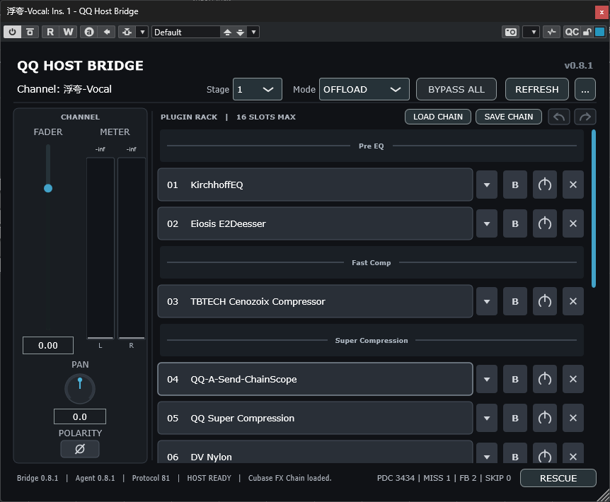

# QQ Host 1.3.14

Qing Audio · **1.3.14 Stable** · 2026-11-04

## 1. 产品介绍 / About the product

QQ Host 是面向 DAW 混音的效果器托管机架。当一条轨道的插件链先于整机 CPU 达到实时处理极限时，可以在轨道 Insert 中放入 QQ Host Bridge，让配套后台 QQ Host 承载效果器。工程、路由及自动化仍由 DAW 管理，不需要另开一个混音系统。

QQ Host is an effect rack for DAW mixing. When one track's plug-in chain reaches its real-time processing limit before the computer's overall CPU is fully used, insert QQ Host Bridge and let its companion background app host the effects. The DAW continues to manage the session, routing and automation; no separate mixer is required.

混音时可测量负载、应用缓冲和分段方案，也可用 ▲ / ▼ 调整 buffer；录音监听可切换 LIVE。每个 Bridge 提供最多 16 个主插件槽和 2 个侧链效果器槽，并支持 Divider、预置、自动化、DAW 工程恢复、Classic / Light / Dark 界面及电平、声像和极性控制。Windows 托管原生 64 位 VST2/VST3 效果器，macOS 另支持 AUv2/AUv3 效果器。

For mixing, measure the workload and apply a buffering/stage plan, or adjust buffering with ▲ / ▼. Switch to LIVE for immediate monitoring. Each Bridge offers up to 16 main slots and two sidechain-effect slots, plus Dividers, presets, automation, project recall, Classic / Light / Dark themes, and level, pan and polarity controls. Windows hosts native 64-bit VST2/VST3 effects; macOS also hosts AUv2/AUv3 effects.

图示保留真实的 0.9.2 历史界面标识；当前界面及操作请看下方 1.3.14 手册。
The image retains its original 0.9.2 identity; see the 1.3.14 manuals below for the current interface and operation.

QQ Host 改变托管和调度方式，但不会改写第三方插件内部的算法。性能改善取决于插件、音频缓冲、路由和电脑配置；增加 buffer 会增加延迟，不能消除持续的处理超负荷。QQ ChainScope 是另行安装的产品，不包含在本包中。

QQ Host changes hosting and scheduling, not the DSP algorithms inside third-party effects. Benefits depend on plug-ins, audio buffering, routing and hardware. More buffering adds latency and cannot remove sustained overload. QQ ChainScope is a separate installation and is not included.

## 2. 许可证 / License

QQ Host 为 Qing Audio 的闭源专有软件，产品源码不公开。本仓库仅提供公开说明、界面图片及发布成品；下载本页文件不授予源码或额外许可权利。第三方组件的许可独立适用。

QQ Host is closed-source proprietary software from Qing Audio; its product source is not public. This repository contains public documentation, screenshots and release downloads only. Downloading these files does not grant source-code or additional license rights. Third-party component licenses apply independently.

## 3. 最新版本下载与说明书 / Latest downloads and manuals

版本 / Version: **1.3.14 Stable** · 发布日期 / Released: **2026-11-04**

[本版发布页 / This release](https://github.com/Qing-Audio/QQHost-Release/releases/tag/v1.3.14)

| 文件 / File | 版本 / Version |
|---|---|
| [Windows x64 VST3](https://github.com/Qing-Audio/QQHost-Release/releases/download/untagged-537b868881cc7ae882dd/QQ.Host.1.3.14.Windows.x64.VST3.zip) | 1.3.14 |
| [macOS Apple Silicon VST3](https://github.com/Qing-Audio/QQHost-Release/releases/download/untagged-537b868881cc7ae882dd/QQ.Host.1.3.14.macOS.Apple.Silicon.VST3.zip) | 1.3.14 |
| [macOS Intel x86_64 VST3](https://github.com/Qing-Audio/QQHost-Release/releases/download/untagged-537b868881cc7ae882dd/QQ.Host.1.3.14.macOS.Intel.x86_64.VST3.zip) | 1.3.14 |
| [macOS Universal 2 AU](https://github.com/Qing-Audio/QQHost-Release/releases/download/untagged-537b868881cc7ae882dd/QQ.Host.1.3.14.macOS.Universal.2.AU.zip) | 1.3.14 |
| [中文安装说明](https://github.com/Qing-Audio/QQHost-Release/releases/download/untagged-537b868881cc7ae882dd/QQ.Host.1.3.14.Installation.Guide.Chinese.txt) | 1.3.14 |
| [English Installation Guide](https://github.com/Qing-Audio/QQHost-Release/releases/download/untagged-537b868881cc7ae882dd/QQ.Host.1.3.14.Installation.Guide.English.txt) | 1.3.14 |
| [中文用户手册（38 页）](https://github.com/Qing-Audio/QQHost-Release/releases/download/untagged-537b868881cc7ae882dd/QQ.Host.1.3.14.User.Manual.Chinese.pdf) | 1.3.14 |
| [English User Manual (38 pages)](https://github.com/Qing-Audio/QQHost-Release/releases/download/untagged-537b868881cc7ae882dd/QQ.Host.1.3.14.User.Manual.English.Edition.pdf) | 1.3.14 |

共 8 个附件：4 个平台包、2 份安装说明和 2 份 38 页手册，均为 1.3.14。GitHub 自动生成的 Source code ZIP/TAR 只是公开页面仓库快照，不包含私有产品源码，也不是插件安装包。

Eight assets: four platform packages, two installation guides and two 38-page manuals, all for 1.3.14. GitHub's automatic Source code ZIP/TAR is only a snapshot of this public documentation repository; it contains neither private product source nor an installable plug-in package.

### 安装与升级 / Installation and upgrades

Windows 包用于 Windows 10/11 x64。Mac 包要求 macOS 12 或更高版本：原生 Apple Silicon 宿主选择 arm64 VST3；Intel 或 Rosetta 宿主选择 x86_64 VST3；Logic 使用包含两种架构的 Universal 2 AU。不要同时安装两套 VST3 架构副本。

The Windows package targets Windows 10/11 x64. Mac packages require macOS 12 or later: choose arm64 VST3 for a native Apple Silicon host, x86_64 VST3 for Intel or Rosetta, and the dual-architecture Universal 2 AU for Logic. Do not install duplicate VST3 architecture packages.

升级前保存工程，完全退出 DAW、扫描程序和 QQ Host；Bridge 与后台程序必须一起替换。Windows 将完整的 QQ Host Bridge.vst3 和 QQ Host.exe 放在 C:\Program Files\Common Files\VST3\QQ Host\。Mac 将 Bridge 和 QQ Host.app 放在同一个 QQ Host 子目录：VST3 位于 ~/Library/Audio/Plug-Ins/VST3/QQ Host/，AU 位于 ~/Library/Audio/Plug-Ins/Components/QQ Host/。详细系统目录、管理员权限和重新扫描步骤见双语安装说明。

Save the session and fully quit the DAW, scanners and QQ Host before upgrading. Replace the Bridge and companion together. On Windows, place the intact QQ Host Bridge.vst3 and QQ Host.exe in C:\Program Files\Common Files\VST3\QQ Host\. On Mac, keep the Bridge and QQ Host.app together under ~/Library/Audio/Plug-Ins/VST3/QQ Host/ for VST3, or ~/Library/Audio/Plug-Ins/Components/QQ Host/ for AU. The bilingual guides cover system-wide locations, administrator permissions and rescanning.

Mac 成品使用 ad-hoc 签名，未经过 Apple Developer ID 公证。仅在确认下载来源可信后，按安装说明处理隔离提示。既有工程和预置继续保留保存的方案；新实例默认 1 buffer / 1 段。LIVE 不增加整块缓冲等待，但内部插件本身的延迟仍在。

Mac bundles are ad-hoc signed, not Apple Developer ID notarized. Follow the quarantine guidance only after verifying the download's trusted origin. Existing projects and presets retain their saved plans; new instances default to 1 buffer / 1 stage. LIVE adds no whole-block buffering wait, but hosted plug-in latency remains.

### 兼容性与验证范围 / Compatibility and verification scope

不支持 32 位插件或乐器。固定单声道／立体声的效果器会进行适配，但不会获得其原生不支持的布局。FL Studio Wrapper 的 Troubleshooting 中需启用 Use fixed size buffers 和两个 maximum-buffer 选项。完整的本地 ChainScope A/B/C 组分段需要兼容的 ChainScope 1.8.1 或后续兼容版本；旧版、不完整、跨 Host 或含 D 的组保留保护。

32-bit plug-ins and instruments are unsupported. Fixed mono/stereo effects are adapted without gaining unsupported native layouts. In FL Studio Wrapper Troubleshooting, enable Use fixed size buffers and both maximum-buffer options. Splitting a complete local ChainScope A/B/C group requires compatible ChainScope 1.8.1 or a later compatible version; older, incomplete, cross-Host or D-containing groups retain protection.

本版复用已完成的 Windows 构建、安装核验和 16 项隔离回归；Mac 成品核对版本、架构、可执行权限及签名。原生 Mac DAW 的界面与声音验收未进行，不代表所有第三方插件与宿主组合都已经验证。

This release reuses the completed Windows build, installation checks and 16 isolated test runs. Mac packages are checked for version, architecture, executable permissions and signature. Native Mac DAW GUI/audio acceptance has not been performed; this is not certification of every third-party plug-in and host combination.

## 4. 逐版本更新记录 / Version history

### 1.3.14 — 缓冲调节与声道切换 / Buffer adjustment and channel switching

2026-11-03：用户指定 Stable；2026-11-04：发布。
User-selected Stable on 3 November 2026; released on 4 November 2026.

中文：用 ▲ / ▼ 直接增加或减少一个 buffer，最低为 1；无需先测试或等到出现 MISS。保持当前处理段数，播放中请求的调整在停止后应用。LIVE、离线渲染及正在恢复或应用方案时仍保留保护。修复 DAW 在单声道与立体声之间切换后，内部效果器没有同步声道布局的问题；保留插件实例与参数，固定声道插件通过适配处理。中英文说明书已在原有章节更新，均为 38 页。既有工程、预置及已保存处理方案保持兼容；Bridge 与后台必须一起升级。16 项 Windows 隔离回归已通过；实际效果取决于插件和系统，增加缓冲不能消除持续超负荷。原生 Mac DAW 界面及声音验收未进行。

English: Use ▲ / ▼ to add or remove one buffer, down to a minimum of 1, without first measuring or waiting for a MISS. The current stage grouping is retained; adjustments requested during playback apply after stopping. Safety gates remain during LIVE, offline rendering, restoration and plan application. Fixes hosted effects not following DAW mono/stereo layout changes, preserving plug-in instances and parameters and adapting fixed-channel effects. Both manuals have been updated in their existing chapters and contain 38 pages. Existing projects, presets and saved processing plans remain compatible; upgrade the Bridge and background app together. Sixteen isolated Windows test runs passed. Results depend on the plug-ins and system; buffering cannot remove sustained overload. Native Mac DAW GUI/audio acceptance has not been performed.

## 5. 历史版本下载 / Previous release downloads

[历史版本、插件与对应资料 / Earlier versions, plug-ins and matching documents](https://github.com/Qing-Audio/QQHost-Release/releases)
